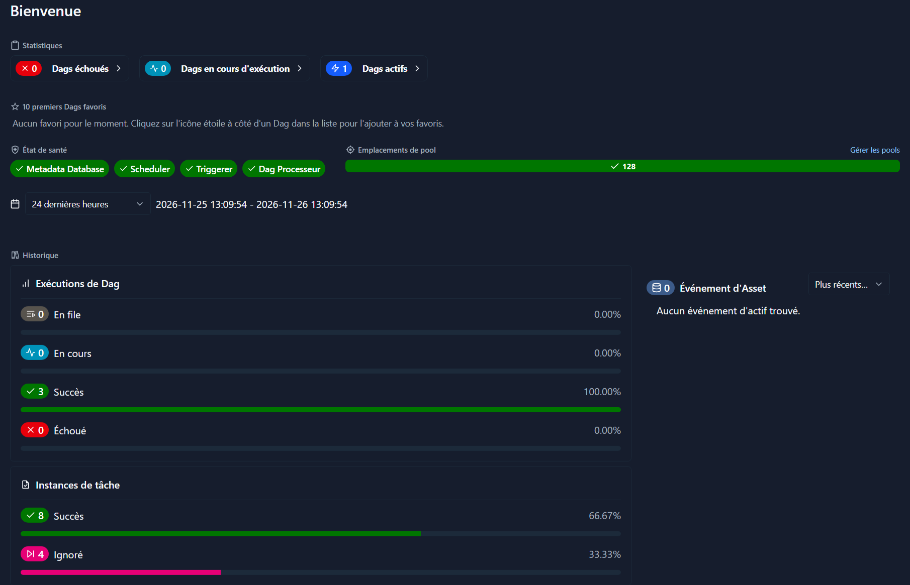
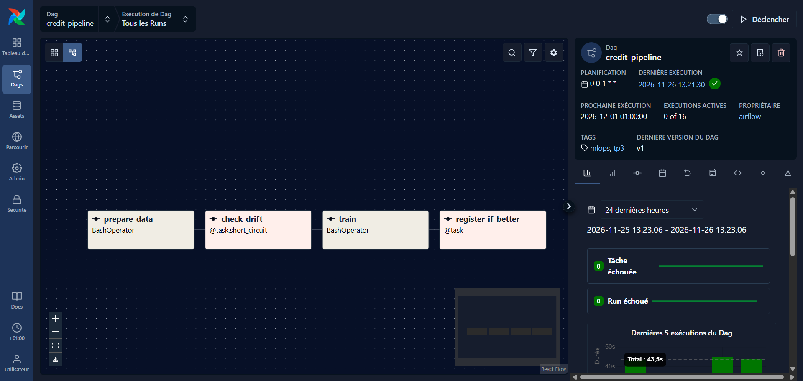
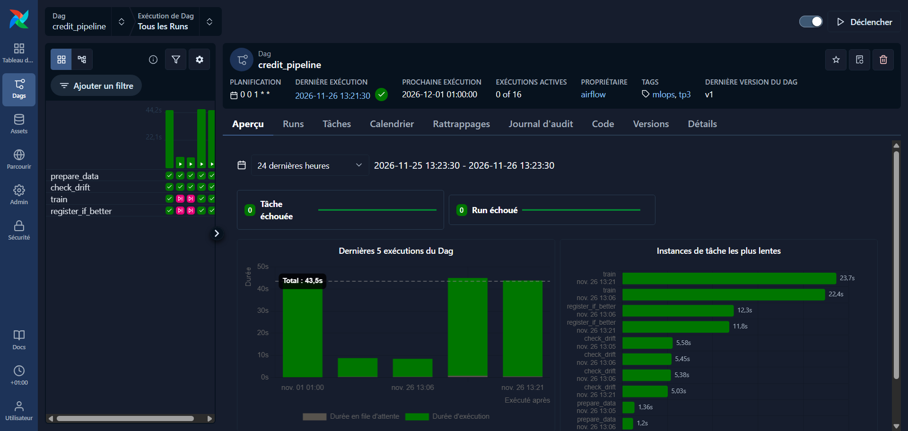
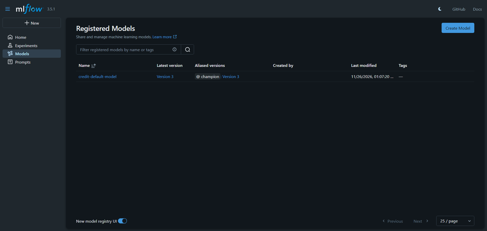
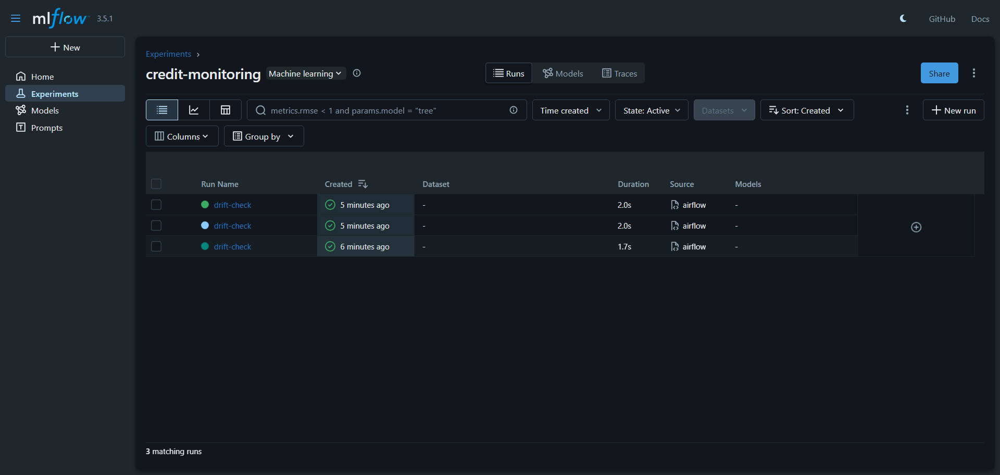
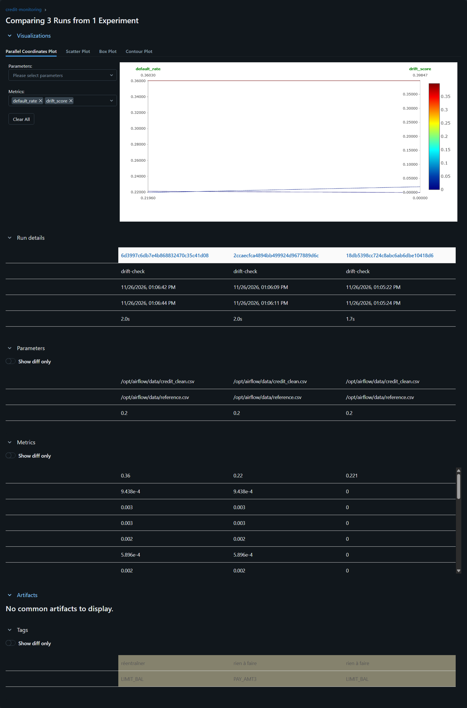

# TP 3 – MLflow dans Airflow

## Partie 0

J'ai copié le CSV du TP 2 dans `data/` et j'ai repris les 3 variables MLflow de mon `.env` du TP 2. Après `docker compose build`, `docker compose up airflow-init` et `docker compose up -d`, tous les services sont en healthy.

Vérification dans le conteneur :
```
3.18.0 https://dagshub.com/ilya32e/credit-mlops.mlflow
```



On voit que tout est en bon état (Scheduler, Triggerer, Dag Processeur...). Sur les 4 lancements : 3 exécutions en succès sur les dernières 24 h et 0 échec (la 4e, celle du 1er novembre, est hors de la fenêtre), 8 tâches réussies et 4 ignorées (les train et register_if_better des 2 lancements sans dérive).

## Partie 3

Le DAG dans Airflow avec ses 4 tâches dans l'ordre :



Premier lancement (celui qui part tout seul quand on active le DAG) : les 4 tâches sont en vert.
- prepare_data : `30000 lignes, 24 colonnes, taux de défaut = 22.1%`
- check_drift : `Aucune donnée de référence : premier entraînement.`
- train : recall = 0.595
- register_if_better : `Champion : version 1 (recall = 0.628 sur les mêmes données)` puis `Le champion reste en service.`

J'avais déjà un champion du TP 2 (la logreg avec 0.628), le RandomForest fait moins bien donc le pipeline ne l'a pas mis en service.

Deuxième lancement avec les mêmes paramètres : train et register_if_better sont skipped (en rose).
```
drift_score = 0.000 (seuil 0.2) -> pas de dérive : on garde le modèle
```
Normal, ce sont exactement les mêmes données que la référence.

## Partie 4

Lot normal : `drift_score = 0.021`, pas de dérive, train et register_if_better skipped.

Lot de crise : `drift_score = 0.398`, c'est LIMIT_BAL qui a le plus bougé. Le taux de défaut passe à 36%. Les 4 tâches tournent :
```
Challenger : rf-balanced (recall = 0.751)
Champion : version 1 (recall = 0.581 sur les mêmes données)
Nouveau champion : credit-default-model version 3
```
Le champion passe de 0.628 à 0.581 sur les données de crise, le nouveau modèle fait 0.751 donc il le remplace. Chez moi j'ai 0.581 et pas 0.475 comme dans l'énoncé parce que mon champion c'était la logreg du TP 2 et pas le RF. Et c'est la version 3 parce que le TP 2 avait déjà fait les versions 1 et 2.

Dans la grille d'Airflow on voit tous les lancements (une colonne par lancement, de gauche à droite) :
1. premier lancement : tout en vert
2. relance avec les mêmes données : train et register_if_better en rose (ignorées)
3. lot normal : pareil, ignorées
4. lot de crise : tout en vert
5. un lancement en plus que j'ai fait après (voir plus bas) : tout en vert



Dans le Registry, l'alias champion est bien passé sur la version 3 (capture prise avant le 5e lancement) :



Dans MLflow, l'expérience credit-monitoring a 3 runs drift-check, un par contrôle (le premier lancement n'en a pas car il n'y avait pas encore de référence) :



En sélectionnant les 3 runs et en cliquant sur Compare, on voit bien que le run de crise (la ligne rouge) est tout seul en haut avec drift_score = 0.398 et default_rate = 0.36, alors que les deux autres sont tout en bas. En bas de la page, dans les tags, on a la décision (réentraîner / rien à faire / rien à faire) et la variable qui a le plus bougé (LIMIT_BAL / PAY_AMT3 / LIMIT_BAL) :



**Lancement en plus (retour à la normale)**

Après la crise j'ai relancé le DAG avec le bouton Déclencher, donc avec le fichier d'origine. Comme la référence était devenue le lot de crise, il y a eu de la dérive dans l'autre sens :
```
drift_score = 0.573 (seuil 0.2) -> DÉRIVE : réentraînement
Challenger : rf-balanced (recall = 0.595)
Champion : version 3 (recall = 0.567 sur les mêmes données)
Nouveau champion : credit-default-model version 4
```
Le modèle de crise marche moins bien sur des données normales (0.567), donc le pipeline a remis un modèle entraîné sur les données normales. C'est un peu comme si la crise était finie et que le pipeline s'adaptait tout seul. Le champion est donc maintenant la version 4.

**Pour aller plus loin**

Avec un seuil de 0.01, les deux lots dépassent (0.021 et 0.398), donc on réentraînerait même pendant un mois normal alors qu'il n'y a que de petites variations dues au hasard. Ça fait des réentraînements pour rien.

Avec un seuil de 0.5, aucun lot ne dépasse, donc la crise ne serait pas détectée et on garderait un modèle qui est devenu moins bon (0.581 au lieu de 0.751).

C'est une décision métier parce que ça dépend de ce que ça coûte à la banque : réentraîner et valider un modèle a un coût, mais garder un mauvais modèle aussi (des clients qui ne remboursent pas). C'est à la banque de choisir quel risque elle accepte, pas juste une question de stats.

## Questions

**Q1.**
- Lancer l'entraînement chaque mois : Airflow (c'est le `schedule="@monthly"`).
- Retrouver les paramètres du modèle en service : MLflow (on va dans Models, on prend la version avec l'alias champion et on regarde son run).
- Relancer une tâche qui a échoué : Airflow (bouton Clear sur la tâche, ou les retries).
- Savoir quand la dérive a commencé : MLflow, avec l'expérience credit-monitoring où on a un drift_score à chaque contrôle.

Airflow gère quand et dans quel ordre ça tourne, MLflow garde l'historique.

**Q2. a)** Elle est dans la tâche `train` du DAG, dans le `bash_command` :
```
python scripts/train.py --data data/credit_clean.csv --model rf --class_weight balanced --n_estimators 200 --max_depth 8
```
Pour faire une régression logistique, il faut modifier le DAG et mettre `--model logreg` à la place de `--model rf`. On ne touche pas à train.py parce qu'il sait déjà faire les deux modèles avec ses arguments. Le script reste le même partout (à la main, en CI, dans Airflow), c'est juste la commande qui change.

**b)** C'est docker compose qui lit le `.env` sur mon PC et qui passe les variables MLFLOW_TRACKING_URI, USERNAME et PASSWORD aux conteneurs (c'est écrit dans le docker-compose.yaml avec `${...}`). Dans le conteneur `load_dotenv()` ne trouve rien, mais MLflow lit directement ces variables d'environnement. Donc train.py envoie bien ses runs sur DagsHub sans qu'on change le code.

**Q3.**
1. Ça évite de gaspiller du temps et des ressources : réentraîner sur les mêmes données donne le même modèle, donc ça sert à rien (et en plus il faut renvoyer le modèle sur DagsHub à chaque fois).
2. On garde un modèle stable. Si on change de modèle tous les mois sans raison, on a plein de versions inutiles dans le Registry et c'est plus dur de suivre ce qui est en production.

**Q4.** Parce que le recall enregistré à l'époque a été calculé sur les anciennes données. Si on compare ce chiffre avec le recall du challenger calculé sur les nouvelles données, on ne compare pas la même chose. Il faut tester les deux modèles sur le même jeu de test pour que ce soit juste. Et ce qui nous intéresse c'est comment le champion marche maintenant, pas avant. On le voit bien avec la crise : la logreg avait 0.628 au TP 2 mais seulement 0.581 sur les nouvelles données.

**Q5.** Par exemple si la moyenne reste la même mais que la répartition change. Disons que la banque augmente le plafond de crédit de certains clients et baisse celui des autres de la même quantité : la moyenne de LIMIT_BAL ne bouge pas mais les données ont changé.

Autre cas : les clients ont le même profil qu'avant mais ils font plus souvent défaut (à cause d'une crise par exemple). Les variables ne bougent pas donc le drift_score reste bas, alors que le modèle se trompe de plus en plus. La cible n'est pas prise en compte dans le calcul de la dérive.

**Q6.** Je pense que non. Un modèle de crédit décide qui a le droit à un prêt, donc c'est sensible, il faut pouvoir l'expliquer et vérifier qu'il ne discrimine pas certains clients. En plus le pipeline ne regarde que le recall : un modèle qui dirait "défaut" pour tout le monde aurait un recall de 1 et gagnerait, alors qu'il serait inutilisable.

Je proposerais que le pipeline fasse tout automatiquement mais qu'au lieu de mettre directement l'alias champion, il mette un alias "challenger". Ensuite quelqu'un de l'équipe vérifie les métriques (recall mais aussi precision, AUC...) et c'est seulement après validation qu'on passe le modèle en champion. Et si ça se passe mal on peut toujours remettre l'ancienne version puisqu'elle reste dans le Registry.
